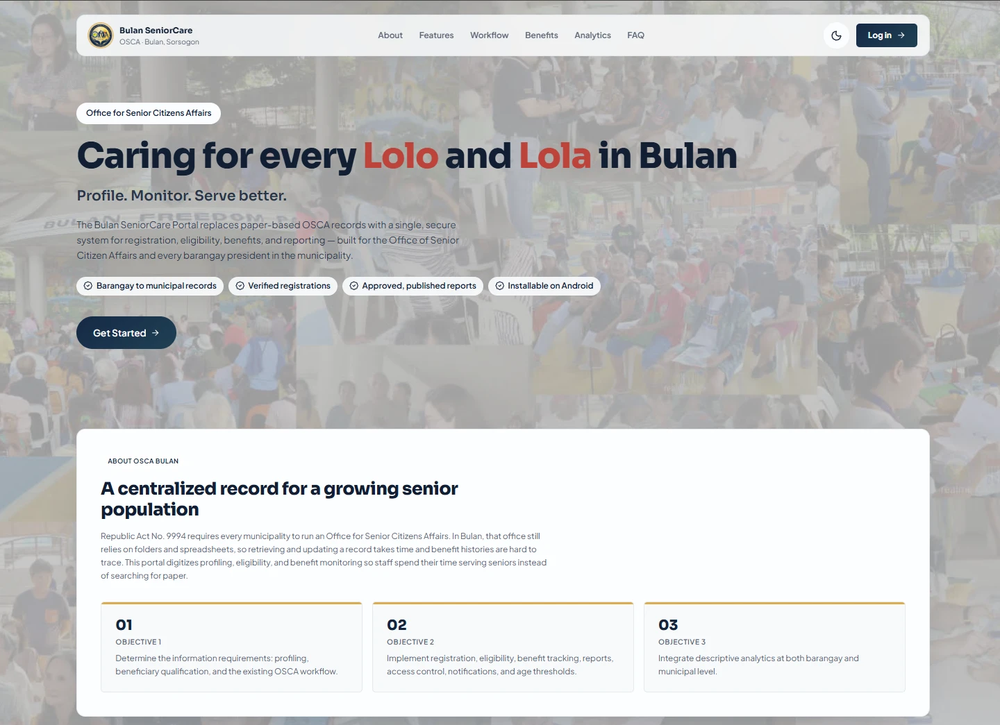

# Bulan SeniorCare

**Senior citizen profiling and benefit monitoring system for the Office of Senior Citizen Affairs (OSCA), Municipality of Bulan, Sorsogon.**

Bulan SeniorCare is a web-based portal that OSCA staff and barangay senior citizen presidents use to register senior citizens, review eligibility, and track the release of benefits. It also produces reports and descriptive analytics for the municipality. It can be installed on Android devices as a progressive web app (PWA).



---

## Table of contents

- [Features](#features)
- [Technology stack](#technology-stack)
- [Architecture](#architecture)
- [Repository structure](#repository-structure)
- [Getting started](#getting-started)
- [Security and privacy](#security-and-privacy)

---

## Features

| Area | Capabilities |
| --- | --- |
| **Senior registration** | Encode profiles, photos, and supporting documents, or bulk-import a barangay list from CSV or Excel. A Data Privacy Consent form is recorded with each registration. |
| **Eligibility review** | The OSCA Head approves or rejects registrations with a reason. Flagged documents go back to the barangay president for correction. |
| **Benefits** | Manage benefit programs, handle benefit requests, and record releases with rosters, payroll sheets, and claim forms (PDF). |
| **Age milestones** | Detect seniors who reach age thresholds automatically, with notifications. |
| **Reports and analytics** | Dashboards, descriptive analytics, and exportable reports (PDF and Excel) with an approval and publishing workflow. |
| **Communication** | Announcements (including imports from the OSCA Facebook Page), in-app messaging with attachments, and notifications. |
| **Administration** | User management, role permissions, audit logs, and database backups. |

### User roles

| Role | Scope |
| --- | --- |
| **Administrator** | Full system access, including user management and settings. |
| **OSCA Head** | Municipal records, eligibility decisions, age thresholds, reports, and analytics. |
| **Barangay president (BSCA)** | Seniors and benefit requests of their own barangay. |

Each role works under its own URL prefix (`/admin`, `/head`, `/bsca`). Accounts are issued by the administrator; there is no public sign-up.

---

## Technology stack

| Layer | Technology |
| --- | --- |
| Frontend | React 19, TypeScript, Vite, TanStack Start / Router / Query, Tailwind CSS 4, Radix UI |
| Backend | Laravel 12 (PHP 8.2+), Laravel Sanctum |
| Database | MySQL |
| Hosting | Railway (application and database); optionally Vercel for the frontend |
| Email | SMTP, Brevo, Mailjet, or a Gmail relay (see [`docs/gmail-relay`](docs/gmail-relay)) |

---

## Architecture

The repository holds two applications that ship as a single service:

- **`frontend/`**: a React single-page application (SPA) containing all pages and UI features.
- **`backend/`**: a Laravel REST API at `/api/*`. In production it also serves the built SPA, so the frontend and API share one origin.

Authentication uses an API token held in an **HttpOnly, `SameSite=Strict` cookie**. The token is never exposed to page scripts or saved in browser storage. Because the cookie must stay first-party, the browser always calls `/api` on the site's own origin:

- **Local development:** the Vite dev server proxies `/api` and `/storage` to Laravel.
- **Railway (single service):** Laravel serves both the SPA and the API.
- **Vercel + Railway:** Vercel forwards `/api` and `/storage` to the Railway backend.

---

## Repository structure

```
.
├── backend/            Laravel API (app, routes, migrations, seeders, tests)
├── frontend/           React SPA (routes, components, lib)
├── docs/               Deployment guide and Gmail relay script
├── postman/            Postman workspace settings
├── Dockerfile          Multi-stage build: frontend + Laravel in one image
└── railway.json        Railway build, deploy, and health-check settings
```

---

## Getting started

### Prerequisites

- Node.js 24 and npm
- PHP 8.2 or later and Composer
- MySQL 8

### 1. Backend

```bash
cd backend
composer install
cp .env.example .env
php artisan key:generate
```

Set the `DB_*` variables in `backend/.env` for your local MySQL database, then run:

```bash
php artisan migrate --seed
php artisan serve --host=127.0.0.1 --port=8000
```

### 2. Frontend

In a second terminal:

```bash
cd frontend
npm ci
npm run dev
```

The dev server proxies `/api` and `/storage` to `http://127.0.0.1:8000`. To point it elsewhere, set `VITE_API_PROXY_TARGET`.

### Demo accounts

The development seeder creates sample accounts for each role. Their sign-in details are defined in `backend/database/seeders/DatabaseSeeder.php`.

> [!WARNING]
> These accounts are for local development only. Never run the development seeder against a production database.

---


## Security and privacy

- Personal information is processed under the **Data Privacy Act of 2012 (RA 10173)**. The portal publishes a Privacy Policy, Terms of Service, Refund Policy, and Cookie Policy at `/privacy-policy`, `/terms-of-service`, `/refund-policy`, and `/cookie-policy`.
- Sessions use an HttpOnly cookie and expire after inactivity. Signed-in profile data and API responses are kept in memory only.
- Access is controlled by role-based permissions, and changes to records are written to an audit log.
- Private documents are served only to authorized, signed-in users.

To report a security issue, contact the repository owner directly rather than opening a public issue.

### Applying the browser security protections

The backend and frontend share `backend/resources/browser-security.json`. Production responses restrict scripts to this site's files and hashes of the built startup scripts, deny framing, and disable MIME sniffing. Inline styles remain allowed because the component library uses style attributes; arbitrary inline JavaScript and script event handlers are blocked. PDF previews use same-origin/blob frames. Fonts and their licenses are shipped in `frontend/public/fonts`, so the portal no longer loads a third-party stylesheet requiring SRI. Keep license notices in bundled dependencies; they are not secrets.

API responses (including login, errors and cookie-authenticated requests) and uploaded-file responses use `Cache-Control: no-store, private`. Hashed public JavaScript/CSS can still be cached. A scanner's “Retrieved from Cache” or “Modern Web Application” informational finding does not by itself require disabling public asset caching.

For local production-style testing, run from the repository root:

```powershell
cd frontend
npm run build:railway
cd ../backend
php artisan config:clear
php -S 127.0.0.1:8088 -t public public/router.php
```

Start **MySQL in the XAMPP Control Panel** and leave it running. Scan `http://127.0.0.1:8088`, not Vite's development server; Vite needs a relaxed development-only policy for hot reload. JMeter login requests must use a valid account password and an HTTP Cookie Manager for subsequent authenticated requests. Login throttling remains enabled (20 requests/minute per IP and a separate failed-password lockout); a 429 during a load test is an intentional protection.

For Railway, redeploy the changed repository using its Dockerfile. For Vercel, use **`npm run build`** as the build command with `frontend` as the root directory, and enable **Include source files outside of the Root Directory** so the shared policy can be imported. Set `BACKEND_URL` to the Laravel HTTPS origin so `/api` and `/storage` are proxied. The build adds headers to Vercel's generated routing configuration, including static HTML. No deployment is performed by a local build.

Set `APP_ENV=production`, `APP_DEBUG=false`, and the correct HTTPS `APP_URL`/`FRONTEND_URL` on the production backend. Rebuild Laravel's configuration with `php artisan config:cache` after changing environment settings (the Railway Docker startup already does this). Do not change your local database or reset user passwords for a security scan.

`CORS_ALLOWED_ORIGINS` defaults to empty because the browser uses the same-origin `/api` proxy. If a separate browser origin needs direct API access, configure exact comma-separated origins, for example `CORS_ALLOWED_ORIGINS=https://portal.example.com,http://localhost:5173`, then clear/rebuild the configuration cache. Wildcards, paths and arbitrary localhost ports are not accepted. Cross-origin cookies remain disabled; browser login should use the proxy. CORS does not replace authentication and does not restrict tools such as JMeter.

If you serve static files directly with Apache, Nginx or another CDN, that server bypasses `public/router.php`; apply the same headers there or use the supplied router deployment. Do not paste a fixed CSP hash list into your host settings: startup hashes change on every build. Re-scan the deployed HTTPS URL after deployment, checking the HTML, API errors and static assets. Production hosts and ZAP results still require verification on the actual deployment.

The script policy follows [MDN's CSP hash guidance](https://developer.mozilla.org/en-US/docs/Web/HTTP/Reference/Headers/Content-Security-Policy/script-src). If future changes add third-party scripts or styles, pin their bytes and apply [Subresource Integrity](https://developer.mozilla.org/en-US/docs/Web/Security/Defenses/Subresource_Integrity), or serve them locally.

---

© Office of Senior Citizen Affairs, Municipality of Bulan, Sorsogon.
